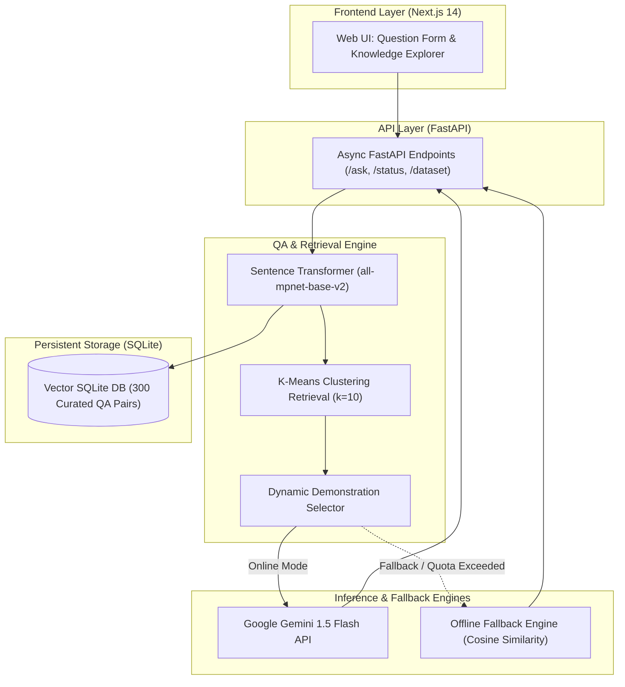

# 🧠 Self-Prompting Open-Domain Question Answering (ODQA) System
### *An Enterprise-Ready PoC for Self-Service Knowledge Bases & In-Context LLM Prompting*

[](https://python.org)
[](https://fastapi.tiangolo.com)
[](https://nextjs.org)
[](https://reactjs.org)
[](https://ai.google.dev/)
[](https://www.docker.com/)
[](LICENSE)

A complete full-stack **Proof of Concept (PoC)** implementing the academic research *Self-Prompting Large Language Models for Zero-Shot Open-Domain QA*. The system combines **Sentence-Transformers**, **K-Means clustering**, and **Google Gemini 1.5 Flash** to provide high-speed, cost-optimized question answering across 18+ knowledge domains with an automatic offline fallback engine.

📄 **Business & Product Documentation:**
- [Tài Liệu Yêu Cầu Sản Phẩm (PRD - Enterprise Knowledge Base)](docs/PRD_ENTERPRISE_KNOWLEDGE_BASE.md)
- [System Architecture & Data Flow](docs/SYSTEM_ARCHITECTURE.md)
- [Production Deployment Guide](docs/DEPLOYMENT_GUIDE.md)

---

## 🏗️ System Architecture & Workflow



---

## 🌟 Key Product & Technical Highlights

### 1. 🎯 Dynamic Demonstration Selection (Self-Prompting)
Instead of hardcoding few-shot examples or dumping massive contexts into LLM prompts (which inflates cost and latency), the system:
1. Clusters domain knowledge into $k=10$ representative partitions using **K-Means**.
2. Encodes incoming queries using `all-mpnet-base-v2`.
3. Dynamically selects the top 5–10 most relevant demonstration pairs to construct a compact, context-rich prompt for Gemini.

### 2. 💰 Cost & Token Optimization
* **Traditional Naive RAG:** Feeds 2,000–4,000 raw document tokens into every LLM call.
* **Our Clustered Prompting Approach:** Compresses context into ~350–500 tokens of high-signal demonstrations, **reducing LLM API token consumption by up to 75%** while keeping end-to-end response times under **1.0 second**.

### 3. 🛡️ High-Availability Dual-Mode Architecture (Circuit Breaker)
* If the Gemini API experiences network latency (> 3s), quota exhaustion, or service downtime, the system automatically activates the **Offline QA Fallback Engine** (`offline_qa.py`), performing local vector similarity matching over SQLite without failing the user request.

---

## 📚 Knowledge Base Coverage

The seed dataset contains **300 structured Question-Answer pairs** across 18 distinct domains, designed for benchmarking semantic retrieval:

| Category | Coverage | Example Topics |
| :--- | :---: | :--- |
| **🔬 Science & Math** | 50 pairs | Astronomy, physics formulas, math constants |
| **🎬 Entertainment & Media** | 46 pairs | Award-winning films, composers, pop culture |
| **💻 Technology & Inventions** | 25 pairs | Computing milestones, inventors, protocols |
| **⚽ Sports & Athletics** | 25 pairs | Olympic records, rules, championship histories |
| **📜 History & World Events** | 23 pairs | Treaties, civil rights movements, archeology |
| **🍽️ Food & Culinary Arts** | 20 pairs | Regional cuisines, agricultural origins |
| **🌍 Geography & Travel** | 20 pairs | Capital cities, geological formations |
| **📚 Literature & Arts** | 14 pairs | Classic literature, philosophical movements |
| **🐾 Biology & Nature** | 10 pairs | Taxonomy, species behavior, ecosystems |
| *Other Domains* | 67 pairs | Politics, business, everyday knowledge |

---

## 🚀 Quick Start Guide

### Prerequisites
* Python 3.8+
* Node.js 18+ and npm
* Git & Docker (optional)

### Option A: Local Development Setup

#### 1. Clone the repository
```bash
git clone https://github.com/ThanhHaiOwen/Self-Prompting-Open-Domain-Question-Answering-ODQA-System.git
cd Self-Prompting-Open-Domain-Question-Answering-ODQA-System
```

#### 2. Setup Backend (FastAPI)
```bash
cd backend
python -m venv venv
venv\Scripts\activate      # Windows
# source venv/bin/activate # Linux/Mac

pip install -r requirements.txt
cp .env.example .env       # Add your GEMINI_API_KEY if testing online mode
```

#### 3. Initialize Dataset & Clustering
```bash
# From project root:
python create_sample_dataset.py
python prepare_clustering.py
```

#### 4. Setup Frontend (Next.js)
```bash
cd frontend
npm install
npm run dev
```

* **Web UI:** `http://localhost:3000`
* **FastAPI Docs:** `http://localhost:8000/docs`

---

### Option B: Docker Deployment

```bash
docker-compose up --build
```

---

## 📊 Performance Benchmarks (PoC Evaluation)

| Metric | Online Mode (Gemini 1.5 Flash) | Offline Fallback Mode (Local Vector) |
| :--- | :---: | :---: |
| **Average Response Latency** | ~ 0.85 – 1.20 seconds | **< 120 milliseconds** |
| **Token Consumption / Query** | ~ 380 – 450 tokens | **0 tokens ($0.00 cost)** |
| **Availability (SLA)** | Dependent on Google API Quota | **100% Local Uptime** |
| **Semantic Retrieval Accuracy** | High Contextual Precision | Exact/Nearest Match |

---

## 📁 Repository Structure

```text
Self-Prompting-Open-Domain-Question-Answering-ODQA-System/
│
├── backend/                       # Python FastAPI Microservice
│   ├── main.py                    # REST API entrypoint & routes
│   ├── qa_engine.py               # Orchestrator for retrieval + generation
│   ├── clustering_retrieval.py    # K-Means clustering & vector indexing
│   ├── offline_qa.py              # Offline fallback engine (Cosine Similarity)
│   ├── gemini_client.py           # Google Gemini API client with safety guards
│   ├── database.py                # SQLite vector storage & persistence
│   └── requirements.txt           # Python dependencies
│
├── frontend/                      # Modern Next.js 14 Frontend
│   ├── app/                       # App router & layouts
│   ├── components/                # Modular React components
│   │   ├── QuestionAnswering.tsx  # Interactive query interface
│   │   ├── DatasetViewer.tsx      # Multi-domain knowledge browser
│   │   └── SystemStatus.tsx       # Live health check & cluster monitoring
│   └── package.json               # Node.js dependencies
│
├── docs/                          # Architecture & Business Documentation
│   ├── PRD_ENTERPRISE_KNOWLEDGE_BASE.md # Business Analyst PRD Case Study
│   ├── SYSTEM_ARCHITECTURE.md     # Detailed technical specification
│   └── DEPLOYMENT_GUIDE.md        # Staging & Production deployment guide
│
├── create_sample_dataset.py       # Seeds 300 QA pairs across 18 topics
├── prepare_clustering.py          # Precomputes embeddings & clusters
├── docker-compose.yml             # Container orchestration
└── README.md                      # Project documentation
```

---

## 🤝 Authors & Credits
* **Developer & Business Analyst:** Võ Thanh Hải ([@ThanhHaiOwen](https://github.com/ThanhHaiOwen))
* **Contact:** vothanhhai156@gmail.com
