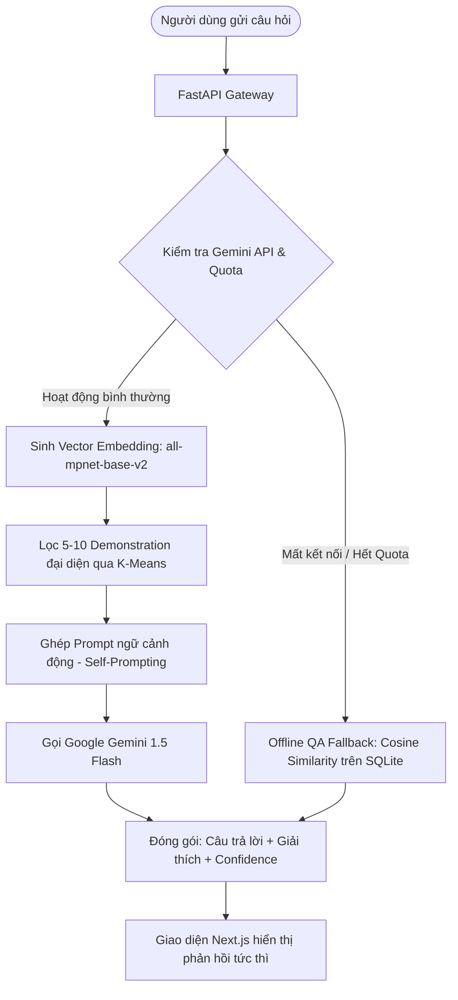

# TÀI LIỆU YÊU CẦU SẢN PHẨM (PRODUCT REQUIREMENT DOCUMENT - PRD)
## Hệ Thống Trợ Lý Tri Thức Tự Phục Vụ Doanh Nghiệp (Enterprise AI Knowledge Base & Self-Service QA)
**Dự án:** Self-Prompting Open-Domain Question Answering System (PoC)  
**Phiên bản:** 1.1.0 | **Tác giả:** Business Analyst / Product Owner: Thanh Hải  
**Trạng thái:** PoC / Ready for Staging Evaluation  

---

### 1. BỐI CẢNH VÀ TỔNG QUAN CHIẾN LƯỢC (EXECUTIVE SUMMARY)

#### 1.1. Vấn đề của doanh nghiệp (Problem Statement)
Trong môi trường doanh nghiệp hiện đại, nhân viên và khách hàng thường xuyên gặp khó khăn trong việc tra cứu tri thức nội bộ (chính sách nhân sự, quy trình IT, thông số sản phẩm, quy chuẩn kỹ thuật). 
* **Thời gian xử lý kéo dài (High AHT):** Nhân viên trung bình mất 15–20 phút để tìm một tài liệu hướng dẫn trong hệ thống wiki/drive rời rạc.
* **Quá tải bộ phận hỗ trợ (Support Overload):** Hơn 60% ticket gửi tới IT Helpdesk hoặc HR là các câu hỏi lặp đi lặp lại.
* **Chi phí API đắt đỏ nếu dùng LLM ngây thơ (Naive RAG/Prompting):** Nhồi toàn bộ tài liệu dài vào context của LLM khiến chi phí token tăng vọt và độ trễ phản hồi cao (> 5–8 giây).

#### 1.2. Tầm nhìn sản phẩm (Product Vision)
Xây dựng một hệ thống **Hỏi - Đáp Tri Thức Tự Phục Vụ (Self-Service Knowledge Base)** kết hợp giữa **Mô hình ngôn ngữ lớn (Google Gemini)** và **Cơ chế Truy xuất Ngữ nghĩa dựa trên Phân cụm (Clustering-based Retrieval)**. 
Hệ thống cho phép người dùng đặt câu hỏi bằng ngôn ngữ tự nhiên và nhận câu trả lời chính xác, kèm lời giải thích trong vòng dưới 1 giây với chi phí token tối ưu nhất.

---

### 2. CHÂN DUNG NGƯỜI DÙNG & USER STORIES

#### 2.1. Personas
1. **Persona A: Nhân viên nội bộ (Frontline Employee - Linh, 24 tuổi)**
   * *Nỗi đau:* Cần tra cứu nhanh chính sách công ty khi đang trao đổi với khách hàng, nhưng không biết tìm ở file nào.
2. **Persona B: Quản trị viên tri thức (Knowledge Manager - Hoàng, 32 tuổi)**
   * *Nỗi đau:* Khó khăn trong việc cập nhật FAQ thủ công; không có hệ sinh thái tự động phát hiện lỗ hổng tri thức.
3. **Persona C: Quản lý kỹ thuật / IT Director (Hải, 38 tuổi)**
   * *Nỗi đau:* Quan ngại về chi phí gọi API LLM hàng tháng và rủi ro gián đoạn dịch vụ khi nhà cung cấp AI gặp sự cố (API Downtime).

#### 2.2. Core User Stories

| ID | Vai trò | Mong muốn (Feature Request) | Mục đích (Business Value) | Độ ưu tiên |
| :---: | :--- | :--- | :--- | :---: |
| **US-01** | Nhân viên | Nhập câu hỏi tự nhiên bằng tiếng Anh/Việt vào thanh tìm kiếm | Nhận câu trả lời ngắn gọn kèm lời giải thích ngay lập tức | **P0 (Must-have)** |
| **US-02** | Nhân viên | Xem chỉ số độ tin cậy (Confidence Score) của câu trả lời | Đánh giá được mức độ xác thực của thông tin trước khi dùng | **P0 (Must-have)** |
| **US-03** | IT Manager | Hệ thống tự động chuyển sang chế độ Offline Matching khi mất kết nối Gemini API | Đảm bảo hệ thống luôn sẵn sàng 24/7 (High Availability) | **P0 (Must-have)** |
| **US-04** | Knowledge Admin | Hệ thống tự động phân cụm tri thức (K-Means) theo 18+ chủ đề | Giúp tổ chức cây tri thức khoa học mà không cần gán nhãn thủ công | **P1 (Should-have)** |
| **US-05** | IT Director | Tối ưu số lượng Prompt Demonstration đưa vào LLM (tối đa 5–10 mẫu) | Giảm thiểu 70% chi phí token API hàng tháng | **P1 (Should-have)** |

---

### 3. ĐẶC TẢ YÊU CẦU CHỨC NĂNG (FUNCTIONAL REQUIREMENTS)

#### FR-01: Bộ máy Sinh và Chuẩn bị Tri thức (Synthetic Knowledge Preparation)
* Tự động tạo lập 300 cặp Hỏi - Đáp phân bố đều trên 18 lĩnh vực chuyên môn (Khoa học, Công nghệ, Lịch sử, Thể thao, Vận hành...).
* Vector hóa toàn bộ câu hỏi và câu trả lời bằng mô hình Sentence Transformers (`all-mpnet-base-v2`), lưu trữ trong SQLite dưới dạng BLOB.

#### FR-02: Cơ chế Phân cụm & Truy xuất Mẫu động (Clustering-based Dynamic Retrieval)
* Áp dụng K-Means ($k=10$) trên không gian vector tri thức để tạo các tâm cụm đại diện cho các miền tri thức.
* Khi người dùng nhập câu hỏi mới:
  1. Tính khoảng cách Cosine giữa câu hỏi và các tâm cụm.
  2. Chọn ra 5–10 câu hỏi mẫu (Demonstrations) có liên quan nhất để đưa vào ngữ cảnh Prompt cho Gemini.

#### FR-03: Cơ chế Dự phòng Ngoại lệ (Dual-mode Fallback & Resilience)
* **Quy tắc chuyển mạch (Circuit Breaker):** Nếu kết nối tới Gemini API vượt quá timeout 3.0 giây hoặc nhận mã lỗi `429 (Too Many Requests) / 5xx`:
  * Hệ thống tự động kích hoạt **Offline QA Engine** (trong module `offline_qa.py`).
  * Sử dụng thuật toán so khớp độ tương đồng Cosine cục bộ để tìm câu trả lời gần nhất trong Database.
  * Gắn cờ `mode: offline` để thông báo cho người dùng biết câu trả lời được lấy từ bộ nhớ đệm cục bộ.

---

### 4. YÊU CẦU PHI CHỨC NĂNG (NON-FUNCTIONAL REQUIREMENTS)

* **Thời gian phản hồi (Latency):**
  * Chế độ Online (Gemini 1.5 Flash + Dynamic Retrieval): $\le 1.2$ giây.
  * Chế độ Offline Fallback: $\le 150$ mili-giây.
* **Khả năng mở rộng (Scalability):** Thiết kế kiến trúc phi trạng thái (Stateless FastAPI), sẵn sàng chạy trong Docker container và triển khai đa vùng qua Nginx.
* **Bảo mật & Quyền riêng tư (Security & PII):**
  * Tích hợp bộ lọc từ khóa cấm và các đại từ nhân xưng rủi ro (`BANNED_PRONOUNS`).
  * Không lưu trữ thông tin cá nhân của người dùng trong log truy vấn.

---

### 5. PHÂN TÍCH TÀI CHÍNH & HIỆU QUẢ KINH DOANH (COST & ROI ANALYSIS)

#### 5.1. Bài toán Tối ưu Chi phí Token (Token Optimization)
* **Phương pháp truyền thống (Naive RAG):** Đưa toàn bộ tài liệu dài (2,000 – 4,000 tokens) vào mỗi lần gọi API.
  * Chi phí ước tính cho 10,000 câu hỏi/tháng: $\approx \$60 - \$120$.
* **Phương pháp Self-Prompting Retrieval:** Chỉ gửi 5 ví dụ ngắn đại diện nhất được chọn lọc qua K-Means ($\approx 350 - 500$ tokens/call).
  * Chi phí ước tính cho 10,000 câu hỏi/tháng: $\approx \$10 - \$18$ (**Tiết kiệm ~75% chi phí vận hành API**).

#### 5.2. Chỉ số Đo lường Hiệu Quả (Business KPIs)
1. **Tỷ lệ chuyển hướng hỗ trợ (Ticket Deflection Rate):** Mục tiêu tự động hóa giải quyết 45% câu hỏi thường gặp mà không cần chuyển tiếp cho chuyên viên hỗ trợ.
2. **Thời gian phản hồi đầu tiên (First Response Time):** Rút ngắn từ 15 phút (chờ nhân viên hỗ trợ) xuống còn **dưới 1 giây**.
3. **Mức độ hài lòng của người dùng (CSAT / Helpful Rate):** Đạt trên 85% đánh giá hữu ích thông qua giao diện Next.js tương tác.
